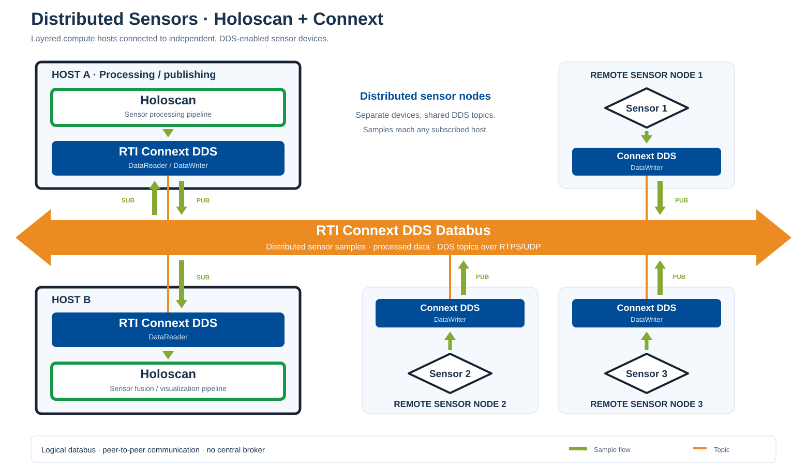

# RTI Connext DDS for NVIDIA Holoscan

Bring the power of RTI Connext to NVIDIA Holoscan applications. This module
makes it easy for Holoscan applications to publish and subscribe to strongly
typed data using the DDS publish/subscribe communication model, without
requiring applications to build and maintain custom point-to-point
connectivity.

Use it to:

- Connect independent Holoscan applications and non-Holoscan systems using a
  standard publish/subscribe communication model.
- Reuse existing DDS data models or define application-owned data types using
  IDL.
- Decouple producers and consumers, allowing applications to evolve
  independently.
- Control how each data flow is delivered using configurable DDS QoS policies.
- Scale from local processes to distributed systems while using the same
  data-centric communication model.

## Why RTI Connext?

[RTI Connext](https://www.rti.com/products/third-party-integrations/nvidia) is
a real-time data-streaming platform for intelligent distributed systems. It
enables applications to share the right data at the right time, wherever they
run.

Connext is designed for systems that require reliable, low-latency, and
scalable data exchange. Built on the Object Management Group (OMG) Data
Distribution Service (DDS) standard, Connext provides:

- Automatic discovery of compatible publishers and subscribers.
- Direct, data-centric communication without an application-level message
  broker.
- Fine-grained QoS control for each data flow.
- Strongly typed interfaces defined with OMG IDL 4 and DDS-XTypes, including
  support for mutable and extensible types.
- A modular architecture that keeps applications decoupled and easier to
  evolve.

## Experimental status

This module is an experimental reference example intended for evaluation and
feedback. It provides a starting point for applications that integrate RTI
Connext DDS with NVIDIA Holoscan. **It is not recommended for production use.**

## Quick start: Shapes with Holoviz

The fastest way to verify the integration is the `connext_shapes_holoviz`
reference application. It generates a moving black square locally, displays it
with Holoviz, and publishes it with the standard RTI Shapes Demo DDS type. The
same application subscribes to external `Square`, `Circle`, and `Triangle`
topics and displays those samples as they arrive.

The SDK, module, and applications build and run inside Docker. Install the
Holoscan CLI on the host as described below; no host installation of the
Holoscan SDK or Connext is required.

Build the Holoscan 5 EA3 development image once, outside this repository:

```bash
git clone --branch v5.0.0-ea3 --depth 1 \
  https://github.com/nvidia-holoscan/holoscan-sdk.git \
  holoscan-sdk-ea3/public

cd holoscan-sdk-ea3/public
CMAKE_BUILD_PARALLEL_LEVEL=2 ./run build_dev_image
```

The resulting `holoscan-sdk-dev-x86_64:v5.0.0-ea3` image (or
`holoscan-sdk-dev-aarch64:v5.0.0-ea3` on ARM64) contains the SDK. The module
uses it directly; no host SDK installation or `--local-sdk-root` is needed.

Install the Holoscan 5 pre-release CLI in a Python 3.11+ virtual environment:

```bash
cd /path/to/rticonnextdds-holoscan-module
python3 --version  # must be Python 3.11 or newer
python3 -m venv .venv-holoscan-cli
.venv-holoscan-cli/bin/python -m pip install --upgrade pip
.venv-holoscan-cli/bin/python -m pip install --pre \
  --extra-index-url https://pypi.nvidia.com \
  'holoscan-cli==5.0.0rc3'
```

Obtain a valid `rti_license.dat` as described in [RTI Connext license](#rti-connext-license)
and place it in the repository root.

Open two terminals in the repository root and activate the virtual environment
in each terminal:

```bash
source .venv-holoscan-cli/bin/activate
test -s rti_license.dat
```

**Terminal 1 — black square:**

```bash
holoscan run connext_shapes_holoviz square
```

**Terminal 2 — red circle:**

```bash
holoscan run connext_shapes_holoviz circle
```

The CLI builds the module container and application as needed, and mounts the
license read-only. These modes require a graphical display. For headless modes
and application options, see the [Shapes + Holoviz guide](applications/connext_shapes_holoviz/README.md).

The two instances exchange Shapes samples through Connext DDS and display both
the locally generated and received shapes in Holoviz.

## What can you do with this module?

The module provides reusable C++ publish and subscribe operators for
application-owned DDS types, CMake-driven Connext type generation from IDL,
XML QoS configuration, and ready-to-run applications.



Holoscan applications on separate hosts exchange samples with distributed
sensor nodes through Connext DDS. Sensor nodes publish through a DDS application
or adapter. The databus represents peer-to-peer communication, with no central broker.

## Start here

Choose the section that matches what you want to do:

| Goal | Read this |
| --- | --- |
| Build the repository and run a first test | [Shapes + Holoviz quick start](#quick-start-shapes-with-holoviz) |
| Build manually, run CTest, or troubleshoot containers | [Advanced container workflow](docs/advanced-container-workflow.md) |
| Understand the DDS and Holoscan terminology | [Concepts and terminology](#concepts-and-terminology) |
| Understand the publisher operator | [Publisher operator](docs/operators/publisher.md) |
| Understand the subscriber operator | [Subscriber operator](docs/operators/subscriber.md) |
| Configure domain, topic, and QoS | [Endpoint configuration](docs/operators/configuration.md) |
| Use typed DDS data inside a Holoscan graph | [Typed Shapes example](applications/shapes_demo_flatbuffers/README.md) |
| Add an application-owned IDL | [Using your own IDL](docs/using-your-own-idl.md) |

## Components

### Reusable operators

- `PublisherOp<DdsType, Adapter>` receives a Holoscan payload, converts it to
  a generated DDS type, and writes it with a Connext `DataWriter`.
- `SubscriberOp<DdsType, Adapter>` receives a generated DDS type with a
  Connext `DataReader`, converts it to a Holoscan payload, and emits it into
  the graph.

Both operators own the Connext participant, topic, reader or writer, QoS, and
lifecycle. Applications provide their data type and the conversion at the
Holoscan/DDS boundary.

### Runnable examples

| Example | Holoscan graph payload | DDS type | Primary purpose |
| --- | --- | --- | --- |
| `shapes_demo_flatbuffers` | FlatBuffers `ShapeT` | `ShapeTypeExtended` | Demonstrate typed DDS conversion |
| `connext_shapes_holoviz` | FlatBuffers `ShapeT` plus Holoviz frame | `ShapeTypeExtended` | Demonstrate local generation, DDS exchange, and Holoviz visualization |

The FlatBuffers example provides independent publisher and subscriber
applications that communicate through DDS, not through an in-process Holoscan
connection. The Holoviz example is one application that
generates a local shape, publishes it, subscribes to the three Shapes topics,
and visualizes both local and received samples.

## Supported versions

| Component | Version |
| --- | --- |
| Module version | `0.1.0` |
| RTI Connext DDS | `7.7.0` |
| NVIDIA Holoscan SDK | `5.0.0 EA3` |
| CUDA | `13` |
| Validated EA3 architecture | `x86_64` |

## Concepts and terminology

### DDS terminology

- **IDL** defines the shared data contract. RTI Code Generator turns the IDL
  into C++ classes and Connext serialization support.
- A **domain** is an isolated DDS communication space identified by a numeric
  domain ID. Only applications using the same domain can discover each other.
- A **topic** combines a topic name and a DDS type. A writer and reader must
  use compatible topic names and types.
- A **DataWriter** publishes samples. A **DataReader** receives samples.
- **Discovery** allows compatible DDS endpoints to find each other without an
  application-level broker.
- **QoS** controls delivery behavior such as reliability, history, durability,
  and resource limits. This repository loads QoS from XML.

### Holoscan terminology

- A **graph** connects processing stages.
- An **operator** is one processing stage in the graph.
- An **input port** receives graph payloads; an **output port** emits them.
- A **payload** is the value carried on a graph edge. Holoscan 5 validates its
  type and, for tensors, its memory and shape contract.
- A **partition** is a group of operators scheduled and deployed together.
- A **NotificationSource** wakes the scheduler when an asynchronous source has
  data. The DDS subscriber uses one instead of polling from `compute()`.

### How the systems meet

Connext-generated C++ classes are not automatically Holoscan graph payloads.
An application supplies an adapter that converts between the two types. The
Shapes examples use a typed FlatBuffers payload:

```text
Holoscan ShapeT <-> ShapeAdapter <-> DDS ShapeTypeExtended
```

Use a companion FlatBuffers schema when Holoscan operators need to inspect or
transform individual DDS fields. The application maintains the schema and
adapter together; the module does not generate that mapping automatically.

### Integration constraints

This module provides a reference integration, not an automatic IDL-to-Holoscan
transport generator. For an application-owned data type, the application must
provide:

- a C++ type generated from its Connext IDL;
- a Holoscan graph payload admitted by the operators in that graph; and
- an adapter that explicitly maps the payload to and/or from the generated DDS
  type.

The DDS endpoints must also agree on the domain, topic name, compatible type
metadata, and requested/offered QoS. The XML QoS file and the generated type
support must be available inside the container at build and runtime. Changes
to an IDL normally require updating the generated type, the adapter, any
companion Holoscan schema, and the integration tests together.

For a step-by-step example, including the CMake code-generation helper and the
two supported payload-boundary choices, see [Using your own IDL](docs/using-your-own-idl.md).

## Requirements

The development setup requires:

- NVIDIA Holoscan SDK `5.0.0 EA3`.
- CUDA `13` and an NVIDIA driver compatible with the EA3 SDK.
- RTI Connext DDS `7.7.0`.
- Docker with the NVIDIA Container Runtime.
- A valid `rti_license.dat` for runtime tests.
- An NVIDIA platform supported by Holoscan 5. IGX Orin is not supported
  because it does not provide the required CUDA 13 platform.

The CLI selects the development image and Connext architecture for the host:

| Architecture | SDK development image | Connext architecture |
| --- | --- | --- |
| x86_64 | `holoscan-sdk-dev-x86_64:v5.0.0-ea3` | `x64Linux4gcc8.5.0` |
| aarch64 | `holoscan-sdk-dev-aarch64:v5.0.0-ea3` | `armv8Linux4gcc8.5.0` |

## RTI Connext license

The source code in this repository is distributed under the RTI license in
`LICENSE` and does not include an RTI Connext runtime license. Request and
download an activation key from the
[RTI Connext license page](https://content.rti.com/l/983311/2025-07-25/q6729c).

Place `rti_license.dat` in the repository root. This file is ignored by Git,
and the example commands mount it read-only at runtime. Keep the license out
of container images and source control.

## Current limitations

- The module is distributed as source; prebuilt module packages are not yet available.
- Python bindings are not included.
- The FlatBuffers adapter is handwritten.
- A native DDS External Topics provider is not implemented.

## Ownership and contact

Vendor: RTI Real-Time Innovations

Contact: `holoscan@rti.com`

## Learn more

- [Connext Developer's Guide](https://community.rti.com/static/documentation/developers/)
- [RTI Connext Professional](https://www.rti.com/products/connext-professional)
- [RTI and NVIDIA](https://www.rti.com/products/third-party-integrations/nvidia)
- [The Connext databus](https://www.rti.com/products/what-is-a-databus)
- [The DDS standard](https://www.rti.com/products/dds-standard)
